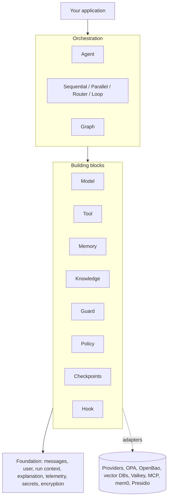

# Architecture and standards

This page explains how sidereon-adk is built, how its folders fit together, and the rules
everyone changing it must follow so it stays simple, safe and consistent. It is written for
anyone who will use, review or extend the library, not only for experts.

Several of the rules below are checked automatically by `tests/test_architecture.py`. If
that test fails, this page tells you why the rule exists and how to fix it.

---

## 1. The idea in one paragraph

An **agent** is a language model that has been given a job (instructions), some actions it
may take (tools), and safety rules. You send it a request; it thinks, uses tools if needed,
and answers. sidereon-adk gives you that agent plus everything around it that real
applications need: choosing any model, memory, your own documents, safety checks, access
rules, saving progress, explanations, monitoring, and testing. Each of these is a small,
separate piece with a simple shape, so you can swap one without touching the others.

---

## 2. The big picture

Think of the library as four floors. Each floor only relies on the floors below it.

```text
┌──────────────────────────────────────────────────────────────────────────────┐
│  YOUR APPLICATION   web service · chat bot · batch job · notebook            │
└──────────────────────────────────────────────────────────────────────────────┘
                 │ run / arun / stream / batch / resume
┌──────────────────────────────────────────────────────────────────────────────┐
│  ORCHESTRATION      Agent · Sequential · Parallel · Router · Loop · Graph     │
│                     (all are "Runnables": same way in, same Response out)     │
└──────────────────────────────────────────────────────────────────────────────┘
                 │ use
┌──────────────────────────────────────────────────────────────────────────────┐
│  BUILDING BLOCKS    Model · Tool · Memory · UserMemory · Retriever · VectorStore│
│                     Embedder · Guard · Policy · CheckpointStore · Hook        │
└──────────────────────────────────────────────────────────────────────────────┘
                 │ built on
┌──────────────────────────────────────────────────────────────────────────────┐
│  FOUNDATION         Message · User · RunContext · Explanation · errors ·      │
│                     telemetry (OpenTelemetry) · secrets · encryption          │
└──────────────────────────────────────────────────────────────────────────────┘
                 │ talk to (only through adapters)
┌──────────────────────────────────────────────────────────────────────────────┐
│  OUTSIDE WORLD      model providers · OPA · OpenBao · vector databases ·      │
│                     Valkey/Redis · MCP servers · mem0 · Presidio · tracing    │
└──────────────────────────────────────────────────────────────────────────────┘
```



Two ideas make the whole design work:

1. **One shape for everything that runs.** An agent, a pipeline, a router and a graph all
   take text in and give a `Response` back, through the same `run()` method. That is why
   they can be nested inside each other, or handed to another agent as a tool.
2. **One small "contract" per building block.** Every building block is a base class with
   one to three methods. The library only talks to the contract, never to a specific
   product. Supporting a new database, model or safety service means writing one new
   class; nothing else changes.

---

## 3. What happens during one agent run

Below is everything an agent does when you call `agent.run("Where is order A-17?")`.
Each step is optional and only happens if you configured it.

| # | Step | Done by | Notes |
|---|---|---|---|
| 1 | **Start**: create a `RunContext` (who is asking, session, run id) and open a trace span | `Runnable.arun` | Every run is traced |
| 2 | **Check the request**: each guard may mask personal data or block the request | `guards` | Blocked runs stop here and return `blocked=True` |
| 3 | **Load the conversation** for this `session_id` | `Memory` | |
| 4 | **Recall facts about the user** from earlier conversations | `UserMemory` | Skipped for anonymous users |
| 5 | **Look up documents** related to the request | `Retriever` (keyword or vector) | Results become `response.sources` |
| 6 | **Decide which tools this user may see** | `Policy` (e.g. OPA) | Hidden tools are invisible to the model |
| 7 | **Save progress** | `CheckpointStore` | Only with `checkpoints` and a `session_id` |
| 8 | **Ask the model**, sending instructions, history, facts, documents and visible tools | `Model.chat` | Token usage and duration recorded |
| 9 | **Run requested tools**, in parallel. For each: policy check with the exact arguments → approval if required → run → result back to the model | `ToolRunner` | Errors and refusals go back to the model, not to the user |
| 10 | **Pause** if a tool needs a person's approval and no `approve` callback is set | `Agent` | Needs `checkpoints` and a `session_id` (otherwise the tool is refused). Returns `paused=True`; continue later with `resume()` |
| 11 | Repeat 7-9 until the model answers (or `max_steps` is reached) | `Agent` | |
| 12 | **Check the answer** with the guards | `guards` | Reversible masking puts real values back here |
| 13 | **Read typed output** if an `output_type` was requested (one retry) | `_output` | |
| 14 | **Remember** the exchange (conversation and user facts) | `Memory`, `UserMemory` | |
| 15 | **Finish**: save the final result, attach the explanation, close the span | `Agent` | `response.trace_id` points to the trace |

Throughout the run, each step is written down twice: as an **event on the trace** (for
monitoring) and, when `explain=True`, as a **step in `response.explanation`** (for people).

---

## 4. Workflows

* `Sequential`, `Parallel`, `Router` and `Loop` are small classes that call other runnables
  in a fixed pattern. They contain no model logic of their own (except the router's
  one-line choice).
* `Graph` runs any flow: steps (nodes), arrows (edges), decisions (conditional edges),
  waiting points (joins) and loops. It runs everything that is ready at the same time,
  in rounds.
* With `checkpoints`, a graph saves its position after every round. If an agent inside it
  pauses for approval, the whole graph pauses and `graph.resume(...)` continues both.
* A workflow is itself a runnable, so workflows can contain workflows.

---

## 5. Folder structure

```text
sidereon-adk/
├── src/sidereon_adk/              the library
│   ├── __init__.py              the public front door: everything users import
│   │
│   │   Foundation
│   ├── errors.py                AgentError and its kinds (Config, Model, Tool, Output)
│   ├── messages.py              Message, ToolCall, Usage
│   ├── context.py               User (who), RunContext (this run), note() for explanations
│   ├── explain.py               Explanation and Step: the human-readable run record
│   ├── telemetry.py             OpenTelemetry setup, spans and metrics
│   ├── secrets.py               SecretStore, secret(), use_secrets(): where credentials come from
│   ├── encryption.py            Encryptor: encrypt stored data
│   ├── openbao.py               OpenBao login, OpenBaoSecrets, OpenBaoTransit
│   ├── _async.py                helpers to run async code from normal code
│   ├── _output.py               turning model replies into typed objects
│   │
│   │   Building blocks (each folder/file = one contract + its built-in versions)
│   ├── tools/                   Tool, Toolset, @tool, schema from type hints
│   ├── models/                  Model, OpenAI-style, Anthropic, Gemini, custom, picker
│   ├── guards/                  Guard, MaskingGuard, PII, keyword, Presidio,
│   │                            LlamaFirewall, Hugging Face classifiers, moderation
│   ├── policy/                  Policy, AllowAll, RolePolicy, OPAPolicy
│   ├── memory/                  Memory (conversation), UserMemory (long-term), Redis, mem0
│   ├── knowledge/               Document, Retriever, embeddings, VectorRetriever,
│   │   └── stores/              one adapter per vector database
│   ├── checkpoints/             CheckpointStore, in-memory, file, Redis
│   ├── hooks.py                 Hook: watch steps (audit, cost)
│   │
│   │   Results and running
│   ├── response.py              Response and ToolRecord
│   ├── runnable.py              Runnable: run/arun/batch/as_tool + tracing for all
│   ├── _tool_runner.py          one tool call: policy → approval → run → record
│   │
│   │   Orchestration
│   ├── agent.py                 Agent and its run loop
│   ├── workflows.py             Sequential, Parallel, Router, Loop
│   ├── graph.py                 Graph, START, END
│   │
│   │   Add-ons
│   ├── mcp.py                   tools from MCP servers
│   ├── redteam.py               attack suite and report
│   ├── evals.py                 promptfoo provider
│   └── testing.py               ScriptedModel for unit tests
│
├── tests/                       unit tests (no network) + architecture rules
├── examples/                    one runnable program per feature or pattern
├── evals/                       promptfoo quality suites, red-team configs
├── policies/                    OPA rules (Rego) and their tests
├── deploy/                      docker-compose for OPA, Jaeger, Valkey, OpenBao;
│                                OpenBao policy and setup script
└── pyproject.toml, Makefile, .pre-commit-config.yaml, .github/workflows/ci.yml

The documentation (these pages) lives in the separate sidereon-docs repository; it reads the
SDK's docstrings, examples and changelog when it is built.
```

Files starting with `_` are internal: users never import them, and they may change freely.

---

## 6. The building blocks and their contracts

| Block | Base class | You implement | Built-in versions |
|---|---|---|---|
| Model | `models.Model` | `async generate(messages, tools)`; optional `stream` | OpenAI-style (15+ providers and local servers), Anthropic, Gemini, Azure, `CustomModel` |
| Tool | `Tool` | `parameters()`, `async call(arguments, context)` | `@tool` functions, agents as tools, MCP tools, retriever as tool |
| Group of tools | `tools.Toolset` | `async tools()` | `MCPServer` |
| Conversation memory | `memory.Memory` | `async load / save / clear` | `InMemory`, `RedisMemory` |
| User memory | `memory.UserMemory` | `async recall / remember / forget` | `LocalUserMemory`, `Mem0UserMemory` |
| Document search | `knowledge.Retriever` | `async search(query, k)` | `KeywordRetriever`, `VectorRetriever` |
| Embeddings | `knowledge.Embedder` | `async embed(texts)` | OpenAI-style, Voyage, Gemini, Cohere, local models, functions |
| Vector database | `knowledge.stores.VectorStore` | `async add / search / delete` | in-memory, FAISS, Chroma, Qdrant, Milvus, Weaviate, PGVector, Elasticsearch, OpenSearch, Pinecone, MongoDB Atlas, Azure AI Search, Astra DB |
| Safety check | `Guard` | `async check_input` and/or `check_output` | keyword, PII patterns, Presidio, LlamaFirewall, Hugging Face classifiers, moderation |
| Personal-data check | `guards.MaskingGuard` | `async find(text)` | `PIIGuard`, `PresidioGuard` (masking, blocking and reversible placeholders are shared) |
| Access rules | `policy.Policy` | `async check(tool, arguments, context)`; optional `allowed_tools` | `AllowAll`, `RolePolicy`, `OPAPolicy` |
| Saved progress | `checkpoints.CheckpointStore` | `async save / load / delete` | in-memory, file, Redis/Valkey |
| Credentials | `secrets.SecretStore` | `get(name)` (not async: used at start-up) | environment variables, `OpenBaoSecrets` |
| Encryption of stored data | `encryption.Encryptor` | `async encrypt(texts) / decrypt(texts)` | `OpenBaoTransit` |
| Observer | `Hook` | any `on_*` method | — |
| Workflow | `Runnable` | `async _run(input, context, **options)` | `Agent`, `Sequential`, `Parallel`, `Router`, `Loop`, `Graph` |

---

## 7. Dependency rules (who may use whom)

Modules are grouped into layers. **A module may only use modules from lower layers.** This
keeps the library easy to understand and stops changes in one place from breaking another.

| Layer | Modules | May use |
|---|---|---|
| 0 Foundation | errors, messages, explain, context, telemetry, secrets, encryption, openbao, _async, _output | each other |
| 1 Building blocks | tools, models, guards, policy, checkpoints, knowledge, memory, hooks | layer 0, plus: knowledge → tools, memory → knowledge and models, policy → tools |
| 2 Results | response | layers 0-1 |
| 3 Running | runnable, _tool_runner | layers 0-2 |
| 4 Orchestration | agent, workflows, graph | layers 0-3 (never each other) |
| 5 Add-ons | mcp, evals, redteam, testing | layers 0-4 |
| 6 Front door | `__init__` | everything |

In practice this means: building blocks never know about agents; agents never know about
graphs; nothing in the library knows about your application.
*Checked by `test_layers_only_depend_downwards`.*

---

## 8. Standards

### 8.1 Naming

* Use plain, generic words: `Agent`, `Memory`, `Guard`, `Policy`, `Document`.
* Product names appear **only** in adapter class names, where they help users pick the
  right one (`QdrantStore`, `PresidioGuard`, `Mem0UserMemory`).
* The project never mentions other agent frameworks or tracing vendors.
  *Checked by `test_project_never_mentions_other_runtimes`.*
* Classes are nouns (`RedTeam`, `VectorRetriever`); methods are verbs (`search`, `resume`);
  booleans read as yes/no questions (`reversible`, `requires_approval`).
* Internal modules and helpers start with `_`.

### 8.2 Adding features

* **Extend, don't edit.** A new integration is a new class implementing an existing contract.
  If you find yourself adding `if provider == "x"` to `agent.py`, stop and add an adapter.
* **Keep contracts tiny.** One to three methods. If a contract needs more, it is probably
  two contracts.
* **Everything that runs is a `Runnable`.** New workflow patterns subclass `Runnable` and
  implement `_run`; they automatically get `run`, `arun`, `batch`, `as_tool` and tracing.
* **Inject, don't hard-code.** Agents receive their parts through the constructor. Adapters
  accept an existing client (`client=`, `analyzer=`, `http_client=`) so callers can reuse
  connections and tests can pass stand-ins.

### 8.3 Optional libraries

* The core needs only `httpx`, `pydantic` and `opentelemetry-api`.
* Any other library is imported **inside the constructor or method that needs it**, never
  at the top of a module. Importing `sidereon_adk` must stay fast and must never fail
  because an optional library is missing.
  *Checked by `test_heavy_libraries_are_imported_only_when_used`.*
* Every optional library gets an install extra in `pyproject.toml` (for example
  `pip install "sidereon-adk[qdrant]"`), and the class docstring names that extra.

### 8.4 Async

* Every contract method is `async`, with one exception: `SecretStore.get` is a normal method
  because credentials are needed while objects are created; implementations cache values.
* Libraries that block (most database clients, Presidio,
  model pipelines) are called with `asyncio.to_thread`.
* Plain functions supplied by users (tools, custom models, approval callbacks, graph
  steps) may be normal or async; the library handles both.
* Sync convenience methods (`run`, `stream`, `batch`, `resume`) exist only at the top, on
  runnables, and simply wrap the async ones.

### 8.5 Safety and privacy

* **Fail closed.** When a safety or access component cannot decide (OPA down, moderation
  service unreachable), the answer is "no". Tools needing approval are refused, or the run
  pauses, when no approver is configured.
* **Least visibility.** Tools a user may not use are hidden from the model, and every call
  is checked again with its real arguments.
* **Credentials only through `secret(NAME)`.** Never read API keys or tokens with
  `os.getenv`; `secret()` lets a secrets manager such as OpenBao supply them.
  *Checked by `test_credentials_are_read_through_secret`.*
* **Right tool for each job.** OpenBao holds credentials and encryption keys; Valkey/Redis
  holds conversations and checkpoints (encrypted with `OpenBaoTransit` when needed). Do not
  store fast-changing data in OpenBao — see [Secrets and encryption](secrets.md).
* **No personal data in monitoring by default.** Prompts, answers and tool arguments are
  only added to traces when `capture_content=True`. Explanation steps hold names, counts
  and reasons, never full texts.
* **Errors stay inside.** Tool failures, unknown tools and refusals are reported to the
  model so it can recover; setup mistakes raise `ConfigError` early.

### 8.6 Saved state

* Anything stored in a checkpoint must be plain data (pydantic models, dicts, lists,
  strings, numbers). Never store clients, functions or open connections.
* Checkpoint keys are `"agent:<name>:<session>"` or `"graph:<name>:<session>"`. Agent names
  should therefore be unique per application.
* Tools may run again if a crash happens *while* a tool is running. Design tools that change
  things (payments, emails) so that repeating them is safe, for example by passing an id.

### 8.7 Monitoring

* Every call to the outside world is wrapped in `telemetry.start_span(...)`.
* Attribute names use the OpenTelemetry AI conventions (`gen_ai.*`) when one exists, and
  `sidereon.*` otherwise.
* Meaningful decisions call `context.note(kind, title, **details)`, which feeds both the
  trace and the explanation.

### 8.8 Errors

* All library errors inherit from `AgentError`: `ConfigError` (set-up problems),
  `ModelError` (provider failed), `ToolError` (tool problems), `OutputError` (answer did not
  match the requested type).
* Error messages say what to do: *"No model given. Pass model=... or set SIDEREON_MODEL."*

### 8.9 Code style

* Formatting and style are enforced by **ruff** (`make format`, `make lint`), with a line
  length of 100. Pre-commit hooks run them on every commit.
* Types are checked by **mypy** (`make typecheck`); every function has type hints.
* Comments explain *why*, not *what*. Public classes and functions have a short Google-style
  docstring (one summary line, then `Args:` and an `Example:` where useful); these
  docstrings become the API reference page automatically.
* `__all__` lists in package `__init__` files are kept sorted.
  *Checked by `test_public_exports_are_sorted_and_real`.*

### 8.10 Tests

* Tests never use the network or real API keys. Use `ScriptedModel` for models,
  `httpx.MockTransport` for HTTP services, and small stand-in clients for databases.
* Coverage must stay **at or above 90%** (`make test` fails otherwise; it is ~98% today).
* Every adapter has a test that checks the exact request it sends and how it reads the reply.
* Quality of answers is tested separately with promptfoo (`make eval`), and safety with the
  red-team suite (`make redteam-quick`, `make redteam`).
* OPA rules have their own tests (`make policy-test`).

### 8.11 Public API and versions

* Anything exported from `sidereon_adk` or a package `__init__` is public.
* Adding is always allowed. Renaming or removing needs a deprecation warning for at least
  one minor release and a note in the changelog.
* Versions follow semantic versioning: patch for fixes, minor for new features, major for
  breaking changes.

### 8.12 Documentation

Every user-visible change updates three things: the guide in the `sidereon-docs` repository,
a runnable example in `examples/`, and (for new features) the table in `README.md`.

---

## 9. Checklists

### Add a model provider

1. If it speaks the OpenAI chat format, add one line to `_OPENAI_STYLE` in
   `models/registry.py`. Done.
2. Otherwise create `models/<provider>.py` with a class extending `HTTPModel` that converts
   messages and tools to the provider's format and reads the reply.
3. Register its prefix in `_providers`; add a test with `httpx.MockTransport`; list it in
   `docs/models.md` in `sidereon-docs`.

### Add a vector database

1. Create `knowledge/stores/<name>_store.py` with a class extending `VectorStore`.
2. Import the client library inside `__init__`; accept an existing `client`.
3. Store id, text and metadata; use cosine similarity; support `filter` as metadata equality.
4. Export it in `knowledge/stores/__init__.py`, add an extra in `pyproject.toml`, a test
   with a stand-in client, and a row in `docs/knowledge.md` in `sidereon-docs`.

### Add a safety or personal-data check

1. For personal data, extend `MaskingGuard` and implement `find` — masking, blocking and
   reversible placeholders come for free.
2. Otherwise extend `Guard` and implement `check_input` and/or `check_output`.
3. Decide what happens when the service is down (default: block).

### Add a tool source (like MCP)

Extend `Toolset`, return `Tool` objects from `tools()`, and pass useful labels in
`tool.metadata` so policies can use them.

### Add a workflow pattern

Extend `Runnable`, implement `_run`, pass `user`, `session_id` and `metadata` down to
the runnables you call, and combine their results with `Response.combine`.

### Add a storage backend (memory, user memory, checkpoints)

Extend the matching base class, store plain JSON, accept an existing client and an optional
`encryptor`, add a test with a stand-in (for Redis, `fakeredis` is used).

### Add a secrets manager or encryption service

Extend `SecretStore` (`get`, with caching) or `Encryptor` (`encrypt`/`decrypt` in batches).
Read the service's own connection settings from its usual environment variables, fail with
`ConfigError` when access is refused, and never put secret values in logs or spans.

---

## 10. Things to avoid

| Don't | Do instead |
|---|---|
| Add product-specific `if` statements to `Agent` | Write an adapter for the contract |
| Import an optional library at the top of a module | Import it where it is used |
| Make a building block call an agent or graph | Pass what it needs as arguments |
| Swallow errors from policies or safety services | Deny, block, or raise clearly |
| Put prompts or personal data in span attributes | Use `capture_content`, or note counts and reasons |
| Read API keys with `os.getenv` | Use `secret("NAME")` |
| Use OpenBao as a database | Keep data in Valkey/Redis; encrypt it with `OpenBaoTransit` |
| Store clients or functions in run state | Store plain data; rebuild clients on resume |
| Write tests that call real services | Use scripted models and stand-in clients |
| Add options "just in case" | Add them when a real use needs them |

---

## 11. Glossary

| Word | Meaning |
|---|---|
| Agent | A model with a job, tools and rules that answers requests |
| Runnable | Anything with `run()` that returns a `Response` (agents and workflows) |
| Tool | An action the model may ask to run, such as looking up an order |
| Session | One conversation, identified by `session_id` |
| User memory | Facts about a person kept across all their sessions |
| Retriever | Finds documents relevant to a question |
| Embedding | A list of numbers representing the meaning of a text |
| Vector store | A database that finds texts with similar meaning |
| Guard | A check on the request or answer (safety, personal data) |
| Policy | Rules about who may see and use which tools |
| Checkpoint | Saved progress of a run, so it can be resumed |
| Secret | A credential such as an API key or token |
| Transit encryption | OpenBao encrypting data for you without ever revealing the key |
| Explanation | A step-by-step, human-readable record of a run |
| Trace / span | Monitoring records of a run and each step inside it |
| Red-teaming | Attacking your own agent to find weaknesses |
