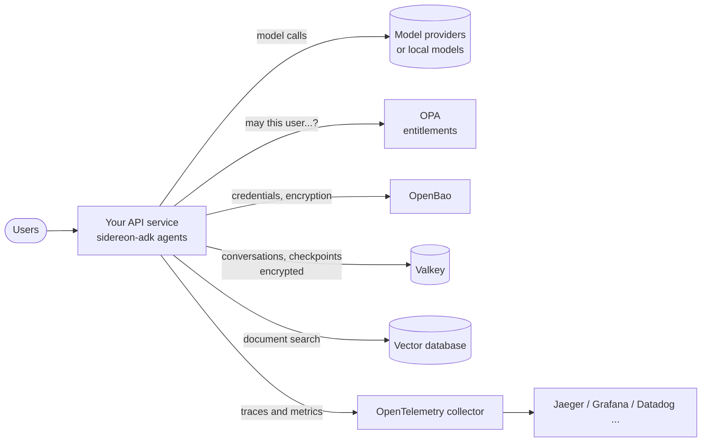

# Production checklist

Everything you need to run agents safely and reliably for real users. Each item links to
the guide with the details.

## Reference setup

## Configuration and secrets

- [ ] No API keys in code, images or `.env` files: `use_secrets(OpenBaoSecrets(...),
      fallback_to_environment=False)` ([Secrets](secrets.md)).
- [ ] The app logs in to OpenBao with AppRole or Kubernetes identity, using the
      least-privilege policy from `deploy/openbao/sidereon-app.hcl`.
- [ ] Models are set explicitly per agent (or with `SIDEREON_MODEL`), with `timeout` and
      `max_retries` suited to your traffic ([Models](models.md)).

## Data

- [ ] Conversations use `RedisMemory` on Valkey with `ttl_seconds` and `max_messages`
      ([Memory](memory.md)).
- [ ] Stored conversations and checkpoints are encrypted: `encryptor=OpenBaoTransit()`.
- [ ] You can honour deletion requests: `memory.clear(session)`,
      `user_memory.forget(user)`, `checkpoints.delete(key)`.
- [ ] Tools that change things (payments, emails) are safe to repeat, because resumed runs
      may repeat a tool that was interrupted ([Checkpoints](checkpoints.md)).

## Access and safety

- [ ] Every agent with side-effecting tools has a `policy` — `OPAPolicy` in production
      ([Policies](policy.md)). Policy tests run in CI (`make policy-test`).
- [ ] Risky tools use `requires_approval=True`, with an `approve` callback or checkpoints.
- [ ] Input guards: prompt injection (`KeywordGuard.prompt_injection()`, `LlamaFirewallGuard`
      or `ClassifierGuard`) and personal data (`PIIGuard` or `PresidioGuard`, ideally
      `reversible=True`) ([Guards](guards.md)).
- [ ] `max_steps` is set to stop runaway tool loops.
- [ ] The red-team suite passes before every release ([Red-teaming](red-teaming.md)).

## Observability

- [ ] `setup_telemetry(service_name, exporter="otlp")` sends traces and metrics to your
      collector ([Observability](observability.md)).
- [ ] `capture_content` stays off unless your monitoring store is approved for personal data.
- [ ] `response.trace_id` is written to your application logs.
- [ ] Dashboards or alerts on `sidereon.tool.calls{outcome="denied"|"error"}`, token usage
      and model latency.
- [ ] Use `explain=True` (or store `response.explanation`) where decisions must be auditable
      ([Explainability](explainability.md)).

## Quality

- [ ] Unit tests with `ScriptedModel` cover tools, policies, guards and workflows.
- [ ] A promptfoo suite checks real answers before each release ([Testing](testing.md)).
- [ ] Coverage stays at or above 90%.

## Serving

- [ ] In async web servers (FastAPI, Starlette), call `await agent.arun(...)` and
      `agent.astream(...)`, never `run()`.
- [ ] Create agents once at start-up and reuse them; they are safe to share between
      requests (pass `user`, `session_id` and `metadata` per call).
- [ ] Limit fan-out with `abatch(..., max_concurrency=...)` and your provider's rate limits
      in mind.
