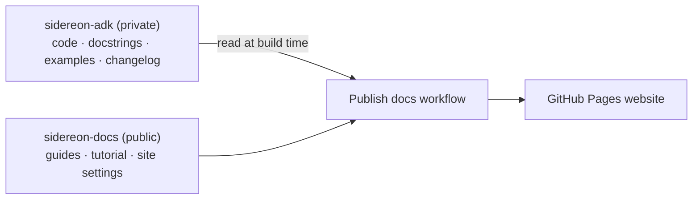
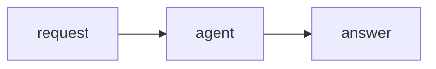

# Writing and publishing docs

The documentation lives in its own repository, **sidereon-docs** (public), and is published
at **https://sidereon.github.io/sidereon-docs/**. The SDK stays in **sidereon-adk** (private).

## How the two repositories stay in sync



| Content | Where you change it |
|---|---|
| Guides, tutorial, architecture, any page | `docs/*.md` in **sidereon-docs** |
| Function and class descriptions (API reference) | Docstrings in **sidereon-adk** |
| Example pages | `examples/*.py` in **sidereon-adk** |
| Changelog page | `CHANGELOG.md` in **sidereon-adk** |

The site is rebuilt and published automatically:

| When | Why |
|---|---|
| Every push to `main` in sidereon-docs | Your page changes go live |
| Every night | SDK changes (docstrings, examples, changelog) go live |
| **Actions → Publish docs → Run workflow** | Publish right now, e.g. after an SDK release |

Pull requests in sidereon-docs are built and checked, but not published. No SDK source code is
ever published — the build fails if it would be.

## Preview locally

Clone both repositories side by side (`sidereon-adk/` next to `sidereon-docs/`), then in
sidereon-docs:

```bash
make install       # .venv with the SDK and the documentation tools
make docs          # live preview at http://127.0.0.1:8000, rebuilds on save
make docs-build    # strict build into _build/html (fails on any warning)
```

## Where things live (in sidereon-docs)

| Path | Contains |
|---|---|
| `docs/*.md` | Guides and pages (one file per page) |
| `docs/index.md` | Home page and the navigation (the `toctree` blocks) |
| `docs/reference/*.md` | API reference pages (`automodule` per SDK module) |
| `docs/conf.py` | Site configuration; finds the SDK at `../sidereon-adk` or `SIDEREON_ADK_PATH` |
| `docs/_static/` | Logo and small CSS tweaks |
| `docs/examples/`, `docs/_from_adk/` | Generated from the SDK on every build — do not edit |
| `.github/workflows/publish.yml` | Builds and publishes the site |

## Writing pages

Plain Markdown works. A few extras are available:

````markdown
```{note}
Admonitions: note, tip, warning, important, seealso.
```

::::{tab-set}
:::{tab-item} pip
`pip install sidereon-adk`
:::
:::{tab-item} uv
`uv pip install sidereon-adk`
:::
::::



```{literalinclude} _from_adk/examples/01_simple_agent.py
:language: python
```
````

Links between pages use the file name: `[Memory](memory.md)` or
`[a heading](architecture.md#9-checklists)`. A new page must be added to a `toctree` in
`index.md`, or the build fails.

Write for readers who are not experts: short sentences, plain words, and an example for
every feature.

## Docstrings (API reference)

Public classes and functions use Google-style docstrings. Code examples inside docstrings
use Markdown fences, which the site turns into highlighted code blocks:

```python
def search(self, query: str, k: int = 4) -> list[Document]:
    """Return up to `k` documents, best match first.

    Args:
        query: The question.
        k: How many documents to return.

    Example:
        ```python
        await retriever.search("leave policy", k=2)
        ```
    """
```

A new SDK module needs a line in the matching `docs/reference/*.md` page in this repository.

## Publishing set-up (one time)

1. **Let the docs build read the SDK.** Create a read-only deploy key on sidereon-adk and
   store its private half as the secret `ADK_READ_KEY` in sidereon-docs:

   ```bash
   ssh-keygen -t ed25519 -N "" -C "sidereon-docs reads sidereon-adk" -f adk_read_key
   gh repo deploy-key add adk_read_key.pub --repo sidereon/sidereon-adk --title "sidereon-docs build (read-only)"
   gh secret set ADK_READ_KEY --repo sidereon/sidereon-docs < adk_read_key
   rm adk_read_key adk_read_key.pub
   ```

2. **Switch on GitHub Pages** in sidereon-docs: **Settings → Pages → Build and deployment →
   Source: GitHub Actions**.

3. Push to `main` (or **Run workflow**). The site appears within a few minutes.

**Custom domain (optional):** set the repository variable `DOCS_BASE_URL` (for example
`https://docs.sidereon.com/`) and add the domain under **Settings → Pages → Custom domain**.

## If publishing fails

| Message | Fix |
|---|---|
| `sidereon-adk not found` / checkout fails with `Permission denied` | The `ADK_READ_KEY` secret or the deploy key is missing (step 1) |
| `Source code pages were built` | Remove `DOCS_SHOW_SOURCE` from the workflow |
| Deploy step says Pages is not enabled | Do step 2 |
| A page has no styling | `DOCS_BASE_URL` does not match the site's address |
